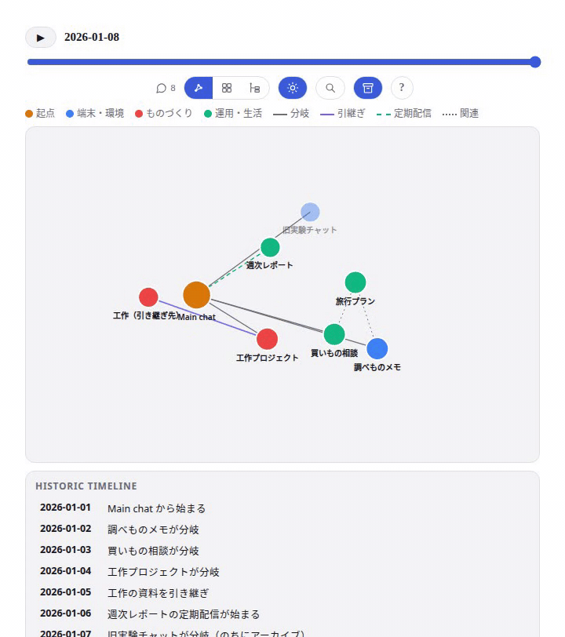

  <picture>
    <source media="(prefers-color-scheme: dark)" srcset="docs/images/logo-dark.svg">
    
  </picture>

# chat-map

  
  
  

  

  <a href="README.md">English</a> · <b>日本語</b>

チャットが Main と多数の Side chat に枝分かれすると、全体像が見えなくなります。chat-map は各スレッドをノード、関係（分岐／引継ぎ／定期配信／関連）をエッジとして一枚の地図にし、日付スライダーと再生で「いつ何が生まれたか」まで辿れるエージェントスキルです。

**ライブデモ：[taisukey.github.io/chat-map](https://taisukey.github.io/chat-map/)** — このリポジトリの `docs/` から配信している、そのままのコードです。

使い方は、Muse にこのリポジトリを渡して「私のチャットの地図を作って」と頼むだけ。テンプレートは現行版の `assets/chat-map-template-v21.html`（グラフ／カード／ツリー、検索、新着ハイライト、色調3種）を使います。日付や関係は記録に基づくものだけを使い、根拠のない日付は「目安」と明記します。

ビューア部分は **keifu（系譜）** として単体でも使えます（依存ゼロの1ファイル）。keifu は 2026-11-27 に独立リポジトリ [github.com/taisukey/keifu](https://github.com/taisukey/keifu) へ移りました（npm では `@taisukey/keifu`）。ノードとエッジの JSON を渡せば、部品表や家系図のようなネットワーク図も同じ仕組みで描けます。[keifu のデモ](https://taisukey.github.io/keifu/demo.html)ではボタンから API を試せます。

テンプレートとデータ形式の静的チェックは `python3 tests/run_tests.py` で実行できます（Python 3 の標準ライブラリのみ、追加インストール不要）。

---

taisukey が Muse と作成。このリポジトリのコミットには `Co-authored-by: Muse` のトレーラを付け、AI との協働を最初から開示しています。
