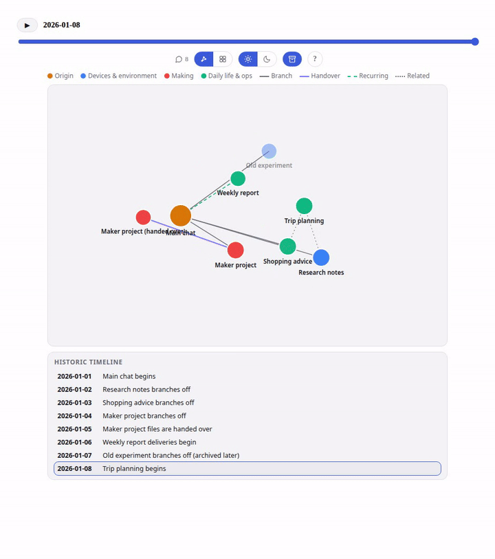
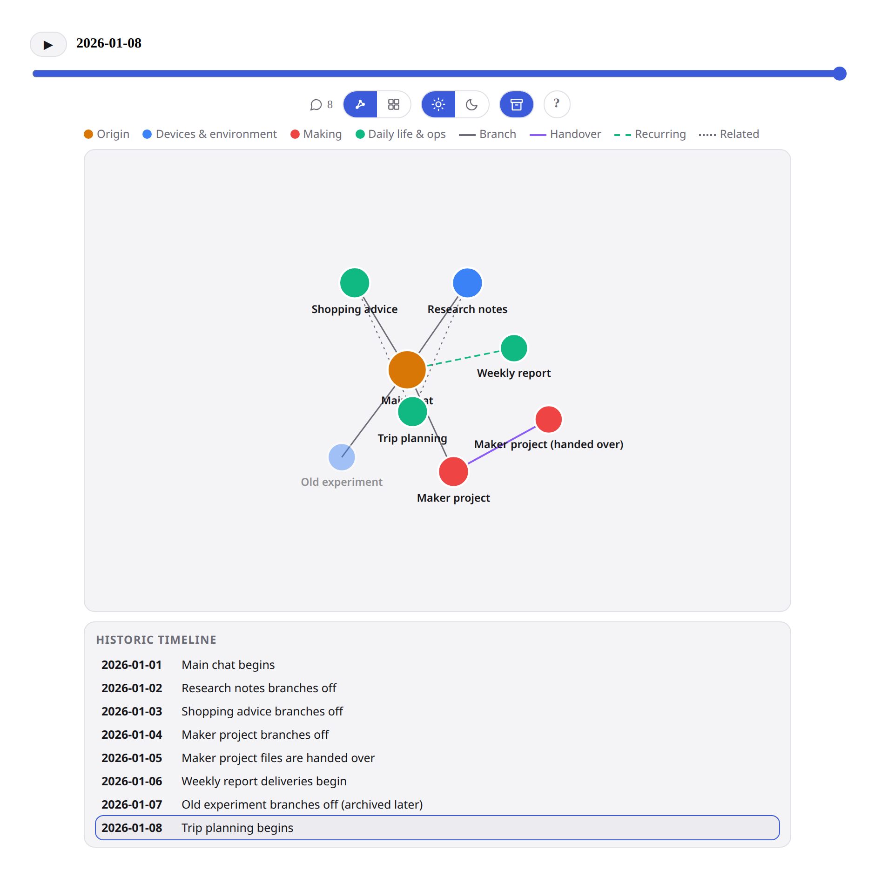
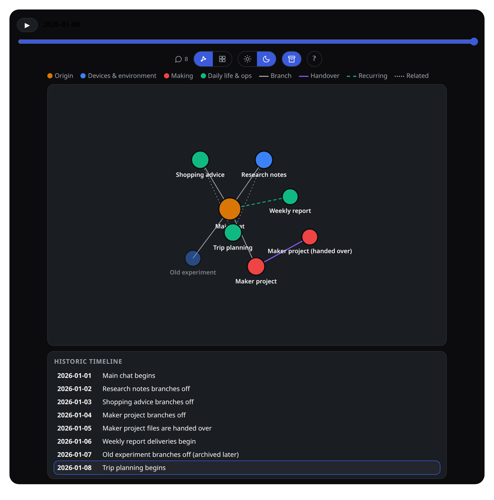
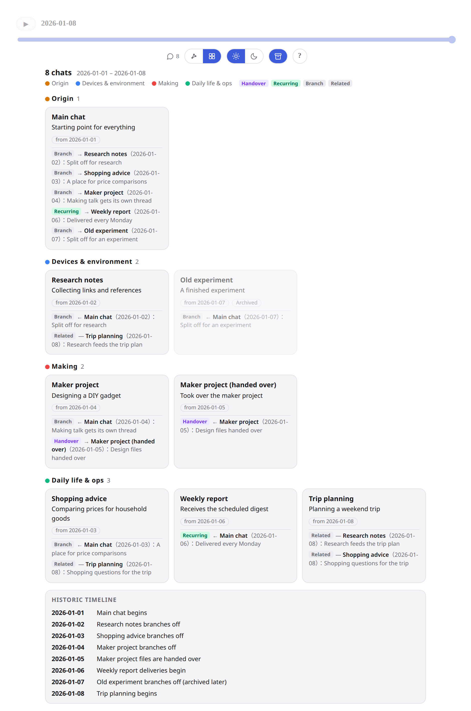
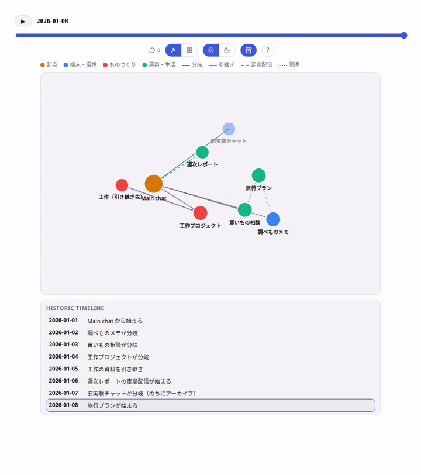

# chat-map

An agent skill that draws your conversation landscape as one map.

When an assistant conversation grows into a main chat plus many side chats, it gets hard to see the whole: which thread branched off from which, what was handed over where, and which thread a scheduled job delivers into. **chat-map** turns that into a single picture — every thread as a node, the relations between them as edges — fused with a historic timeline, so you can scrub or play back the days and watch the landscape grow.

*Graph view with timeline playback: threads appear on the day they began. (Sample data.)*

## What it produces

An interactive widget (force-directed graph + timeline) with:

- **Nodes** — one per chat thread, coloured by theme cluster, archived threads faded
- **Edges** — four kinds: *branch* (a topic split off), *handover* (work or a skill was transferred), *recurring* (a scheduled job delivers there), *related* (same subject, no transfer)
- **Historic timeline** — a day slider and play button; threads and edges appear on the day they began, and a dated event feed lights up in sync
- **Details on tap** — each thread's role, its birthday, and its dated connections

## How it works

The skill is a procedure, not a script:

1. Enumerate the threads (including archived ones)
2. Date each thread from the conversation record; ungrounded dates are labelled estimates — never dressed up as exact
3. Classify relations from evidence only (a split, an explicit handover, a scheduled delivery, a shared subject)
4. Render through the bundled template (`assets/chat-map-template.html`) by replacing its single `DATA` object

It never invents a date or a relation, never posts into the threads it maps, and quotes no conversation content — titles and one-line roles only.

## Layout

- `SKILL.md` — the skill itself
- `assets/chat-map-template.html` — the Graph × Historic Timeline widget template (v1)
- `assets/chat-map-template-v2.html` — the unified widget template (v2)

## v2

The v2 template unifies the graph and a grouped-cards view in one widget, adds a standard/dark tone toggle (colours only — the layout never shifts), and can optionally link timeline entries to Obsidian summary notes via `obsidian://` URIs. Those links only work when the HTML is opened in a real browser: inside Muse's own clients, custom URL schemes are blocked, and the template renders the timeline as plain text there instead. The v1 template remains available as the original graph-only version.

*Graph view in the standard and dark tones.*

*The same landscape as grouped cards.*

## FAQ

**Is this an app?**
No — chat-map is a *skill*: a set of instructions that an AI assistant follows. There is nothing to install and run on its own; the assistant does the work.

**How do I use it?**
Give your Muse assistant this repository (or install the skill) and ask it to "map my chats". The assistant enumerates your threads, dates them from the record, classifies the relations between them, and hands you back a single HTML map like the ones above. You never write code.

**Will it work with my conversations?**
Yes — the map is built from your own conversation record, so its contents are different for everyone. It helps most if you actually use side chats: the more threads and handovers you have, the more the landscape is worth drawing. Dates or relations the record cannot support are labelled estimates, never invented.

**Does it work with other AI agents?**
The skill uses the standard agent-skills format (`SKILL.md`), so other compatible agents may be able to follow it. It has only been verified with Muse.

## 日本語

チャットが Main と多数の Side chat に枝分かれし、引き継ぎや定期配信が絡むと全体像が見えなくなります。chat-map は、各スレッドをノード、関係（分岐／引継ぎ／定期配信／関連）をエッジとして一枚の地図にし、日付スライダーと再生で「いつ何が生まれたか」まで辿れるようにするエージェントスキルです。日付や関係は記録に基づくものだけを使い、根拠のない日付は「目安」と明記します。

*タイムライン再生つきのグラフ表示（サンプルデータ）。*

### よくある質問

**これはアプリですか？**
いいえ、AIアシスタント Muse 用の「スキル」（手順書）です。単体で動くソフトではありません。

**どうやって使うのですか？**
Muse にこのリポジトリを渡して「私のチャットの地図を作って」と頼むだけです。会話の一覧と関係を Muse が記録から集めて、地図のページに仕上げます。コードを書く必要はありません。

**自分の会話でも使えますか？**
はい。自分の記録から作るので中身は人それぞれです。サイドチャットを使い分けている人ほど効きます。記録で裏付けできない日付は「目安」と明記します。

**他の AI エージェントでも使えますか？**
スキルは共通規格（SKILL.md）で書かれているため、理屈の上では他の対応エージェントでも応用できるはずですが、動作確認は Muse のみです。

---

Created by taisukey with Muse. Commits to this repository carry a `Co-authored-by: Muse` trailer — AI collaboration is disclosed upfront, on purpose.
