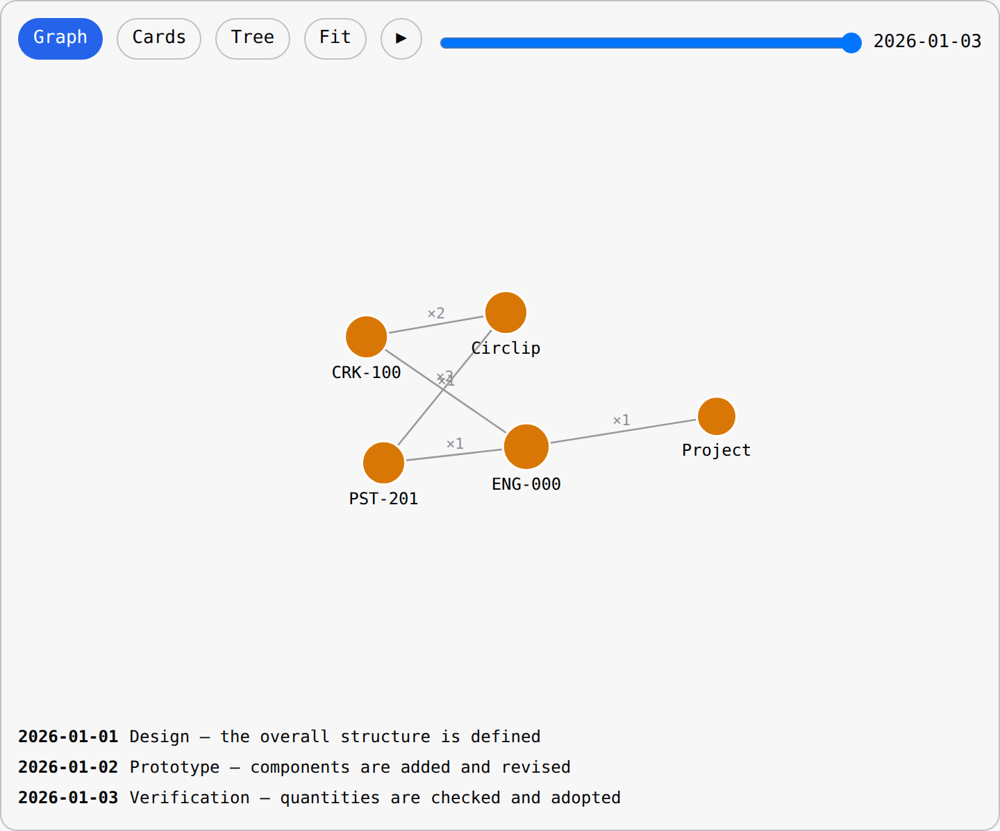
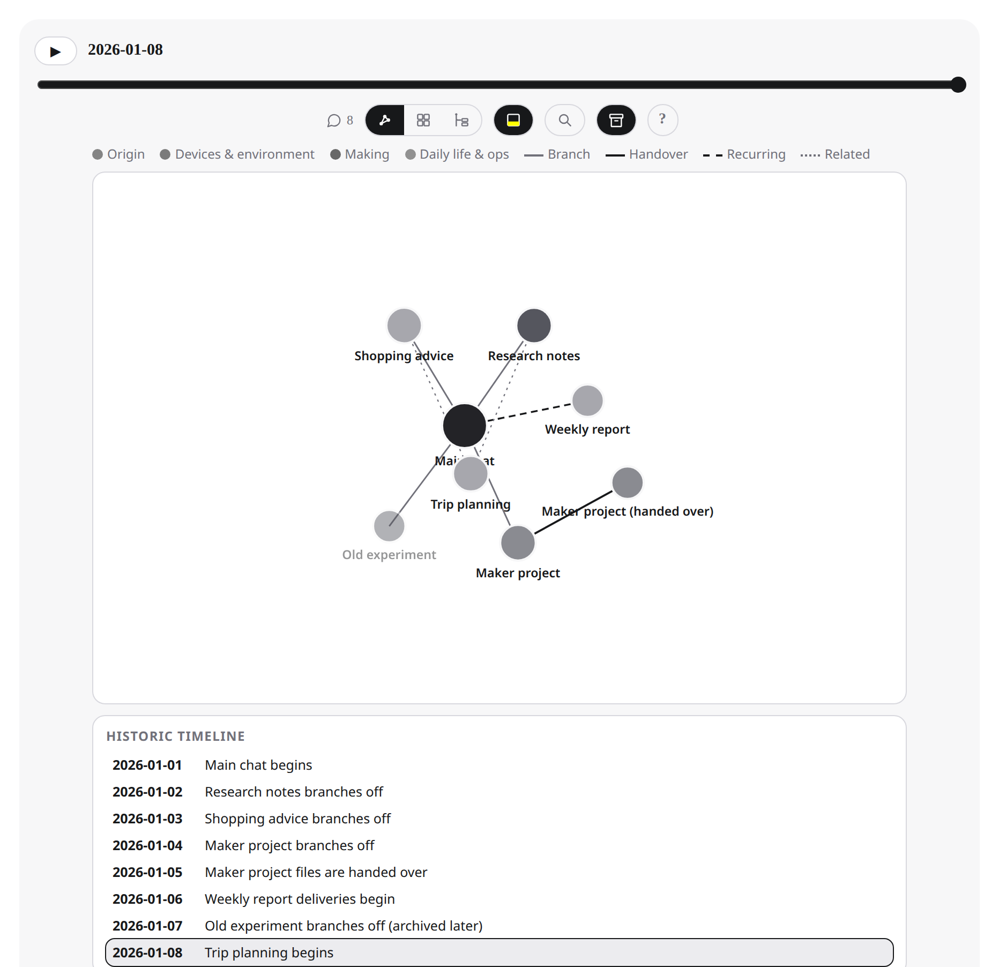

<p align="center">
  <picture>
    <source media="(prefers-color-scheme: dark)" srcset="docs/images/logo-dark.svg">
    
  </picture>
</p>

# chat-map

<p align="center">
  <a href="https://github.com/taisukey/chat-map/releases"></a>
  <a href="https://github.com/taisukey/chat-map/blob/main/LICENSE"></a>
</p>
<p align="center">
  <a href="https://taisukey.github.io/chat-map/"></a>
</p>

A map of your Muse chats: each thread a node, each branch, handover or recurring delivery an edge, on a timeline you can play back. It is a skill — instructions an AI assistant follows — not an app.

**Live demo: [taisukey.github.io/chat-map](https://taisukey.github.io/chat-map/)** — the pages there are served from this repository's `docs/` folder, so what you see is the code in this repo, running.


## Use it

1. Give this repository to your Muse assistant (or install the skill).
2. Ask: **“Map my chats.”**
3. You get back one HTML file with the map of your own threads.

## keifu — the viewer on its own

The viewer underneath also ships separately as **keifu** （系譜， "lineage"): one zero-dependency file. keifu moved into its own repository on 2026-11-27 — [github.com/taisukey/keifu](https://github.com/taisukey/keifu), also on npm as [`@taisukey/keifu`](https://www.npmjs.com/package/@taisukey/keifu). The `keifu/` folder here is kept as a pointer.

```js
var h = keifu.mount(el, { nodes: [...], edges: [...] }, {});
h.setLayout("hierarchy");   // or "force" / "timeline"
```

You get graph / cards / tree views, a detail panel whose composition and where-used lists are derived from the edges, and — when the data carries days — a lineage timeline with playback and ghost display for superseded nodes. The handle adds programmatic control (`select`, `focus`, `filter`, `collapse`, `setData`, …), callbacks, render hooks for nodes and the detail panel, tone presets, and `exportSVG()`. The [keifu demo](https://taisukey.github.io/keifu/demo.html) drives all of it from buttons, so you can try the API without writing code.




What changed in each version is in the commit history and the releases; the demo above is the current state.

## Which template should I use?

The skill renders with `assets/chat-map-template-v21.html`, which carries everything: graph / cards / tree, search, the new-arrival highlight, and the three tones. (The file name follows the template generation, not the release number.) Older templates stay in the repo:

- **v1** (`assets/chat-map-template.html`) — the original graph-only map, the lightest option.
- **v2** (`assets/chat-map-template-v2.html`) — graph + cards, from before the tree view and the mono tone.

## The same viewer on your own website

Nothing about the viewer is specific to chats. Give it nodes and edges as JSON — a family tree, a team chart, the parts of a machine — and it draws the network. One HTML file on your site, your data swapped in; no install, no tracking, works offline. For engineers: plain SVG in a single file, one JSON contract, nodes stay in the DOM (searchable, styleable via CSS variables, readable by screen readers in the card and tree views).

<details>
<summary><b>What it produces</b></summary>

- **Nodes** — one per chat thread, coloured by theme cluster, archived threads faded
- **Edges** — four kinds: *branch* (a topic split off), *handover* (work or a skill was transferred), *recurring* (a scheduled job delivers there), *related* (same subject, no transfer)
- **Three views** — force-directed graph with timeline playback, grouped cards, and a foldable tree
- **Three tones** — standard, dark, and monochrome (mono)
- **Details on tap** — each thread's role, its birthday, and its dated connections

<p>


</p>


*Tree view: clusters as folders, chats as files.*



*The monochrome (mono) tone.*

</details>

<details>
<summary><b>How it works</b></summary>

The skill is a procedure, not a script. The assistant enumerates your threads (including archived ones), dates each from the conversation record — ungrounded dates are labelled estimates, never dressed up as exact — classifies relations from evidence only, and renders through the bundled template by replacing its single `CM_DATA` object.

It never invents a date or a relation, never posts into the threads it maps, and quotes no conversation content — titles and one-line roles only.

Optional: timeline entries can link to Obsidian summary notes via `obsidian://` URIs (works in a real browser; inside Muse's clients the timeline renders as plain text).

</details>

<details>
<summary><b>Layout</b></summary>

- `SKILL.md` — the skill itself
- `assets/chat-map-template-v21.html` — the unified widget (graph / cards / tree × standard / dark / mono)
- `assets/chat-map-template-v2.html` — the previous unified widget (graph / cards)
- `assets/chat-map-template.html` — the original graph-only template (v1)
- `keifu/` — a pointer to keifu's own repository (the component moved out on 2026-11-27)
- `tests/` — static checks for the templates and the `CM_DATA` contract (see below)

</details>

<details>
<summary><b>Checks</b></summary>

Static checks for the templates, the data contract and the README's links — Python 3 standard library only, no installs:

```sh
python3 tests/run_tests.py
```

The same validator can check an exported data file on its own: `python3 tests/run_tests.py --data <file.json>`. Rendering in a real browser is not covered; see `tests/README.md` for exactly what is and is not checked.

</details>

<details>
<summary><b>FAQ</b></summary>

**Is this an app?** No — a *skill*: instructions an AI assistant follows. Nothing to install or run on its own.

**Will it work with my conversations?** Yes — the map is built from your own record. It helps most if you use side chats: the more threads and handovers, the more the landscape is worth drawing.

**Other AI agents?** The skill uses the standard agent-skills format (`SKILL.md`), so compatible agents may follow it. Verified with Muse only.

</details>

## 日本語

チャットが Main と多数の Side chat に枝分かれすると、全体像が見えなくなります。chat-map は各スレッドをノード、関係（分岐／引継ぎ／定期配信／関連）をエッジとして一枚の地図にし、日付スライダーと再生で「いつ何が生まれたか」まで辿れるエージェントスキルです。

**ライブデモ：[taisukey.github.io/chat-map](https://taisukey.github.io/chat-map/)** — このリポジトリの `docs/` から配信している、そのままのコードです。

使い方は、Muse にこのリポジトリを渡して「私のチャットの地図を作って」と頼むだけ。テンプレートは現行版の `assets/chat-map-template-v21.html`（グラフ／カード／ツリー、検索、新着ハイライト、色調3種）を使います。日付や関係は記録に基づくものだけを使い、根拠のない日付は「目安」と明記します。

ビューア部分は **keifu（系譜）** として単体でも使えます（依存ゼロの1ファイル）。keifu は 2026-11-27 に独立リポジトリ [github.com/taisukey/keifu](https://github.com/taisukey/keifu) へ移りました（npm では `@taisukey/keifu`）。ノードとエッジの JSON を渡せば、部品表や家系図のようなネットワーク図も同じ仕組みで描けます。[keifu のデモ](https://taisukey.github.io/keifu/demo.html)ではボタンから API を試せます。


テンプレートとデータ形式の静的チェックは `python3 tests/run_tests.py` で実行できます（Python 3 の標準ライブラリのみ、追加インストール不要）。

---

Created by taisukey with Muse. Commits to this repository carry a `Co-authored-by: Muse` trailer — AI collaboration is disclosed upfront, on purpose.
