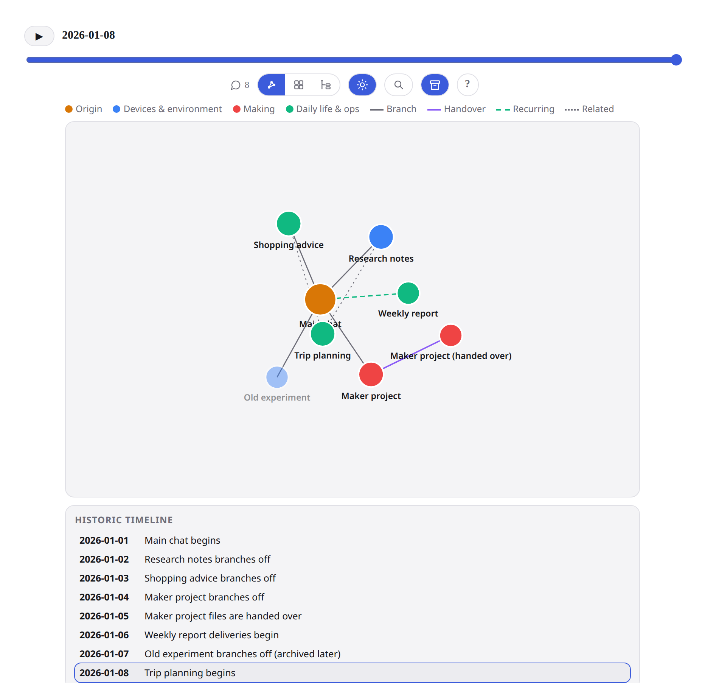
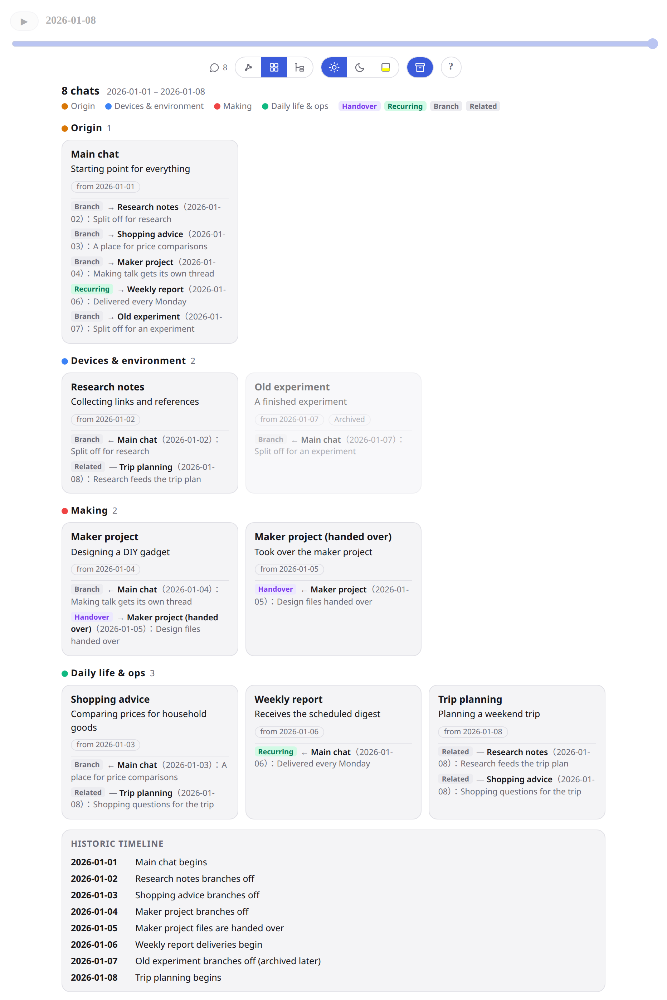
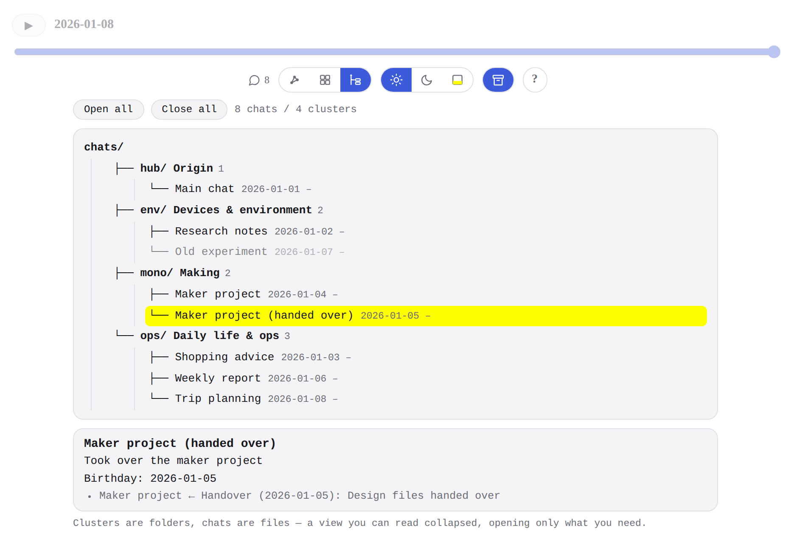
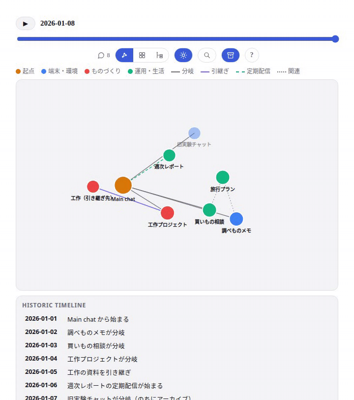

# chat-map

**Your conversation landscape, as one map.** Every chat thread a node, every branch / handover / recurring delivery an edge — with a timeline you can play back day by day.


## Use it

1. Give this repository to your Muse assistant (or install the skill).
2. Ask: **“Map my chats.”**
3. Get back one HTML map of your own threads. No code to write.

## New in v2.2

- **Search** — a magnifier in the bar finds a chat by name or role and jumps to it in whichever view is open (graph, cards or tree).
- **New-arrival highlight** — chats born since you last looked carry a small marker, with a chip that walks you through them; after you have seen them, the chip stays as "Prev" and reopens the same list, so nothing is lost by acknowledging it.
- **One tone button** — the three tone buttons became a single button that cycles Standard → Dark → Mono; its icon shows the tone you are in.
- **Obsidian links restored** — timeline entries can again open notes in the Obsidian iOS app (`vaultIOS`) or a local browser page (`browserUrl`) where those fields are provided.

Earlier: v2.1 added the **tree view** (clusters as folders, chats as files) and the **mono tone** (grey structure, monospace type, one yellow highlight); v2.0 unified the graph and card views in one widget; v1 was the original graph-only map. Full notes: [Releases](https://github.com/taisukey/chat-map/releases).

## Which template should I use?

Use the current one: the skill renders with `assets/chat-map-template-v21.html`, which carries all the features above. (The file name follows the template generation, not the release number — the v2.2 features live in the v21 file.) The older templates stay in the repo for reference, and for anyone who prefers them:

- **v1** (`assets/chat-map-template.html`) — the original graph-only map. The lightest option if the landscape and the timeline are all you want.
- **v2** (`assets/chat-map-template-v2.html`) — graph + cards, from before the tree view and the mono tone.

<details>
<summary><b>What it produces</b></summary>

- **Nodes** — one per chat thread, coloured by theme cluster, archived threads faded
- **Edges** — four kinds: *branch* (a topic split off), *handover* (work or a skill was transferred), *recurring* (a scheduled job delivers there), *related* (same subject, no transfer)
- **Three views** — force-directed graph with timeline playback, grouped cards, and a foldable tree
- **Three tones** — standard, dark, and monochrome (mono)
- **Details on tap** — each thread's role, its birthday, and its dated connections

<p>


</p>





*Tree view: clusters as folders, chats as files.*


*The monochrome (mono) tone.*

</details>

<details>
<summary><b>How it works</b></summary>

The skill is a procedure, not a script. The assistant enumerates your threads (including archived ones), dates each from the conversation record — ungrounded dates are labelled estimates, never dressed up as exact — classifies relations from evidence only, and renders through the bundled template by replacing its single `CM_DATA` object.

It never invents a date or a relation, never posts into the threads it maps, and quotes no conversation content — titles and one-line roles only.

Optional: timeline entries can link to Obsidian summary notes via `obsidian://` URIs (works in a real browser; inside Muse's clients the timeline renders as plain text).

</details>

<details>
<summary><b>Layout</b></summary>

- `SKILL.md` — the skill itself
- `assets/chat-map-template-v21.html` — the unified widget (graph / cards / tree × standard / dark / mono)
- `assets/chat-map-template-v2.html` — the previous unified widget (graph / cards)
- `assets/chat-map-template.html` — the original graph-only template (v1)
- `tests/` — static checks for the templates and the `CM_DATA` contract (see below)

</details>

<details>
<summary><b>Checks</b></summary>

Static checks for the templates, the data contract and the README's links — Python 3 standard library only, no installs:

```sh
python3 tests/run_tests.py
```

The same validator can check an exported data file on its own: `python3 tests/run_tests.py --data <file.json>`. Rendering in a real browser is not covered; see `tests/README.md` for exactly what is and is not checked.

</details>

<details>
<summary><b>FAQ</b></summary>

**Is this an app?** No — a *skill*: instructions an AI assistant follows. Nothing to install or run on its own.

**Will it work with my conversations?** Yes — the map is built from your own record. It helps most if you use side chats: the more threads and handovers, the more the landscape is worth drawing.

**Other AI agents?** The skill uses the standard agent-skills format (`SKILL.md`), so compatible agents may follow it. Verified with Muse only.

</details>

## 日本語

チャットが Main と多数の Side chat に枝分かれすると、全体像が見えなくなります。chat-map は各スレッドをノード、関係（分岐／引継ぎ／定期配信／関連）をエッジとして一枚の地図にし、日付スライダーと再生で「いつ何が生まれたか」まで辿れるエージェントスキルです。

使い方は、Muse にこのリポジトリを渡して「私のチャットの地図を作って」と頼むだけ。現行版 v2.2 では **検索** と **新着ハイライト** が加わり、v2.1 で加わったクラスタをフォルダのように畳める **ツリー表示** と、モノクロ＋黄色ハイライトの **mono 色調** も使えます。テンプレートは通常、現行版の `assets/chat-map-template-v21.html` を使います（グラフだけの軽い地図でよければ、初代 v1 のテンプレートも残してあります）。日付や関係は記録に基づくものだけを使い、根拠のない日付は「目安」と明記します。



テンプレートとデータ形式の静的チェックは `python3 tests/run_tests.py` で実行できます（Python 3 の標準ライブラリのみ、追加インストール不要）。

---

Created by taisukey with Muse. Commits to this repository carry a `Co-authored-by: Muse` trailer — AI collaboration is disclosed upfront, on purpose.
