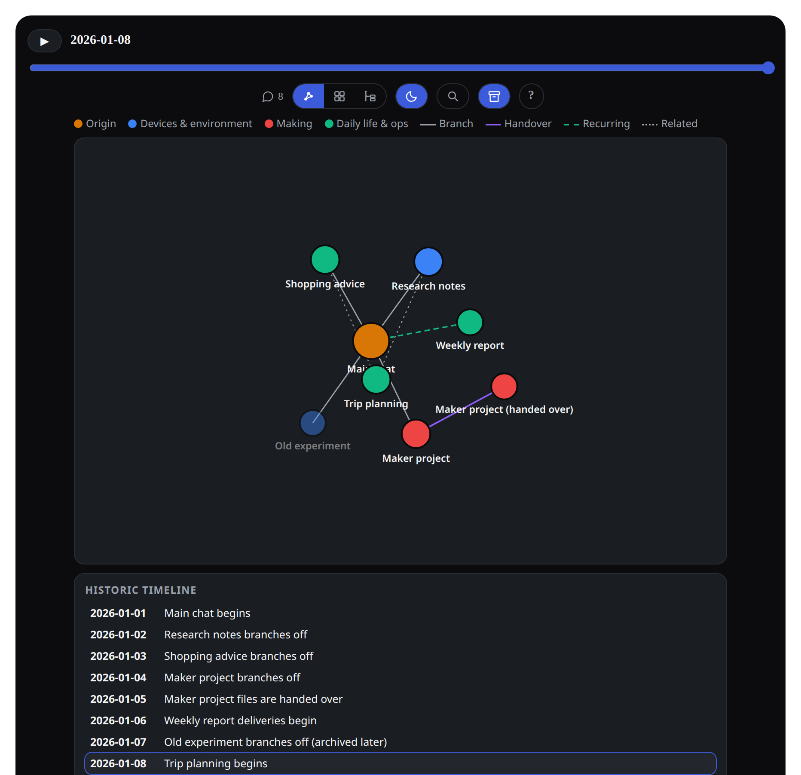

# chat-map

**Your conversation landscape, as one map.** Every chat thread a node, every branch / handover / recurring delivery an edge — with a timeline you can play back day by day.

## Use it

1. Give this repository to your Muse assistant (or install the skill).
2. Ask: **“Map my chats.”**
3. Get back one HTML map of your own threads. No code to write.

## New in v2.1

- **Tree view** — a third view beside Graph and Cards: clusters as folders, chats as files. Collapse everything and open only what you need.
- **Monochrome (***REMOVED***) tone** — a third tone beside Standard and Dark: grey structure, monospace type, and a single yellow highlight for the selected chat. Colours change, layout never moves.

<b>What it produces</b>

- **Nodes** — one per chat thread, coloured by theme cluster, archived threads faded
- **Edges** — four kinds: *branch* (a topic split off), *handover* (work or a skill was transferred), *recurring* (a scheduled job delivers there), *related* (same subject, no transfer)
- **Three views** — force-directed graph with timeline playback, grouped cards, and a foldable tree
- **Three tones** — standard, dark, and monochrome (***REMOVED***)
- **Details on tap** — each thread's role, its birthday, and its dated connections

<b>How it works</b>

The skill is a procedure, not a script. The assistant enumerates your threads (including archived ones), dates each from the conversation record — ungrounded dates are labelled estimates, never dressed up as exact — classifies relations from evidence only, and renders through the bundled template by replacing its single `CM_DATA` object.

It never invents a date or a relation, never posts into the threads it maps, and quotes no conversation content — titles and one-line roles only.

Optional: timeline entries can link to Obsidian summary notes via `obsidian://` URIs (works in a real browser; inside Muse's clients the timeline renders as plain text).

<b>Layout</b>

- `SKILL.md` — the skill itself
- `assets/chat-map-template-v21.html` — the unified widget (graph / cards / tree × standard / dark / ***REMOVED***)
- `assets/chat-map-template-v2.html` — the previous unified widget (graph / cards)
- `assets/chat-map-template.html` — the original graph-only template (v1)

<b>FAQ</b>

**Is this an app?** No — a *skill*: instructions an AI assistant follows. Nothing to install or run on its own.

**Will it work with my conversations?** Yes — the map is built from your own record. It helps most if you use side chats: the more threads and handovers, the more the landscape is worth drawing.

**Other AI agents?** The skill uses the standard agent-skills format (`SKILL.md`), so compatible agents may follow it. Verified with Muse only.

## 日本語

チャットが Main と多数の Side chat に枝分かれすると、全体像が見えなくなります。chat-map は各スレッドをノード、関係（分岐／引継ぎ／定期配信／関連）をエッジとして一枚の地図にし、日付スライダーと再生で「いつ何が生まれたか」まで辿れるエージェントスキルです。

使い方は、Muse にこのリポジトリを渡して「私のチャットの地図を作って」と頼むだけ。v2.1 では、クラスタをフォルダのように畳める **ツリー表示** と、モノクロ＋黄色ハイライトの *****REMOVED*** 色調** が加わります。日付や関係は記録に基づくものだけを使い、根拠のない日付は「目安」と明記します。

---

Created by taisukey with Muse. Commits to this repository carry a `Co-authored-by: Muse` trailer — AI collaboration is disclosed upfront, on purpose.
